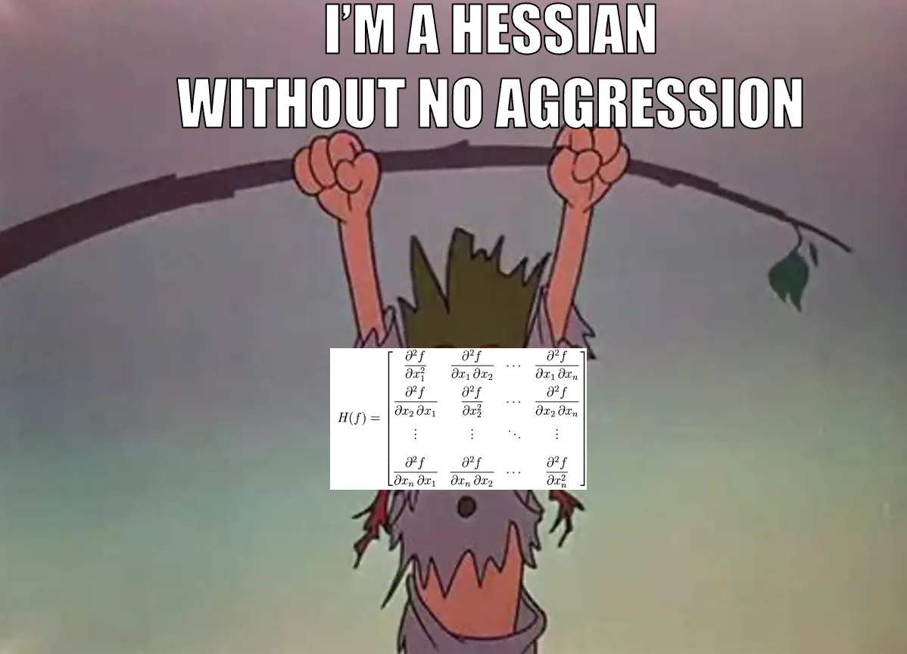
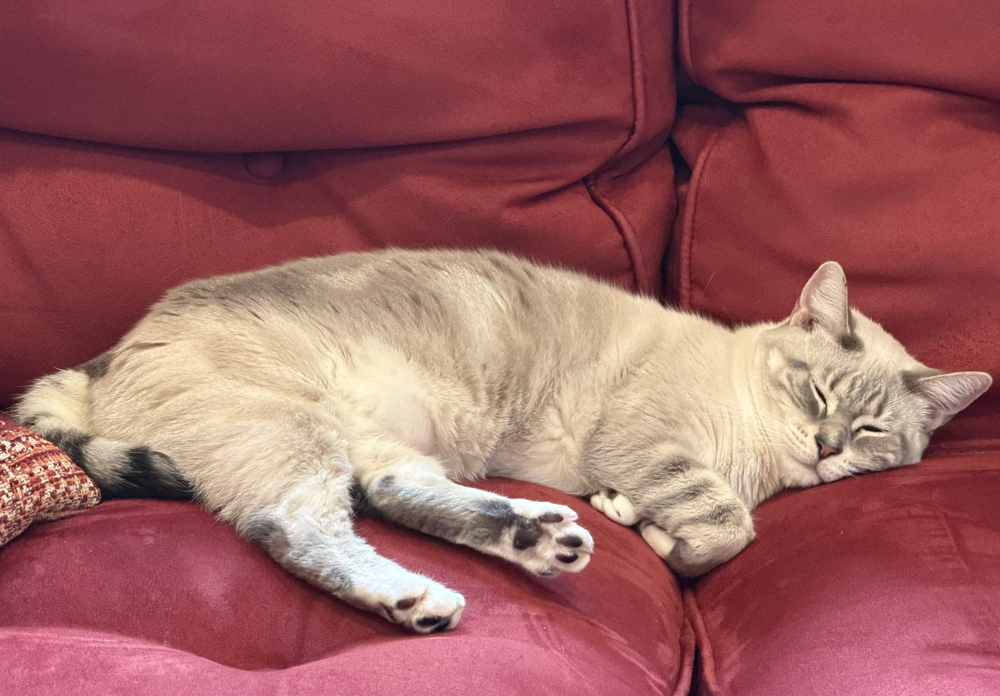

I was deeply intrigued to see [@RTMB](https://onlinelibrary.wiley.com/doi/10.1002/ece3.74572) in Ecology and Evolution the other day. With a title like *RTMB: An R Package for Fitting Latent Variable Models With Template Model Builder* how could I not be intrigued? Latent variables and possibility of SEM? Check! TMB? Well, I'm a regular user of [glmmTMB](https://cran.r-project.org/web/packages/glmmTMB/index.html) and [sdmTMB](https://sdmtmb.github.io/sdmTMB/) - the later of which has just moved over to using RTMB at its core. So, what indeed is RTMB and how does it work?

At its core, RTMB is a way to use TMB and it's AD "machinery" without having to code in C++ and compile your model. Seems great! You make an objective function - kinda just like you did if you are using `optim()` or `nlminb()` and then use `MakeADFun()` to wrap it all up so that it can be fed to one of those optimizers to fit.

There are a few other things you want to do inside of the function. Use `getAll()` so you don't have to do a lot of typing with a `$`. Flag the observed variable using `OBS()`. Use `REPORT()` to get an object you want to see after fitting without uncertainty. Use `ADREPORT()` to get a derived quantity for which you DO want to get some uncertainty.  There are other bits and pieces, but, let's look at this in context using `palmerpenguins`. Or, now that its in base R, `penguins` - haha!


## A Simple Linear Regression model

Let's start by loading in our data and, for the moment, getting rid of NAs.

```{r}
#| label: start
#| messages: false
#| warning: false

library(RTMB)
library(dplyr) # to make our lives easier

penguins_clean <- na.omit(penguins) # get rid of NAs

```

Now, what's our model? Let's look at `bill_len ~ body_mass` as a linear regression. If we were just using lm, this would be

```{r}
#| label: lm

penguin_lm <- lm(bill_len ~ body_mass, data = penguins_clean)
```

This is always lovely, as we don't really have to think about what is going on under the hood. Not so with RTMB. We actually define our model mathematically and estimate parameters. So, to remind you, a linear regression model looks like this:

$$\hat{y_i} = \beta_0 + \beta_1 x_i$$
$$y_i \sim \mathcal{N}(\hat{y_i}, \sigma)$$

To start, we have to actually create a list of parameters as well as some start values. Let's not use betas and sigmas from above, but give them more meaningful names.

```{r}
#| label: params_linreg
linreg_params <- list(intercept = 0,     # starting guesses
              body_mass_slope = 0,
              logsigma = log(sd(penguins_clean$bill_len))) #seems reasonable if all was flat!
```

Note we're doing log sigma. That will make things easier to fit.

Now, we define our model  with an objective function.  We are going to actually have the linear model, the likelihood (the normal distribution for residuals), and then turn that into a negative log-likelihood. Well, ok, we're going to use `dnorm()` so we'll set `log=TRUE` to start out with the log-likelihood, as that's good practice for rounding, etc. We'll make a function with one argument - `p`. What is that? Well, `p` is a list of parameter values - the same one we just made! And we'll use `getAll()` so we don't need to keep typing `p$` or `penguins_clean$` throughout.

1. Supply one argument - `p` - which is a list of our parameter values. We'll then use `getAll()` in order to not have to use `p$` or `penguins_clean$` in the rest of the function.  

2. We will calculate `sigmas` as `exp(logsigma)` and then use `ADREPORT(sigma)` so that we can see it in our coefficient output.  If we wanted to get simulations of it as well, we would include `REPORT(sigma)` for later use with the `simulate()` function

3. One funny thing is that we will use `bill_len <- OBS(bill_len)` - this allows us to define our observed variable, which will then be used in things like calculating residuals, simulations, and more.

4. Do you want fitted values? You have to define them and get them with `ADREPORT()` as well! Which is fine - and menas you can do all sorts of tricksy things - particularly if you want link and response values, etc.

```{r}
#| label: linreg_fun

linreg <- function(p){
  getAll(penguins_clean, p) # so we can stop using $
  
  # a transformed parameter
  sigma <- exp(logsigma)
  ADREPORT(sigma) #so we can see it later
  #REPORT(sigma) #for simulation
  
  # What are we observing for later sims
  bill_len <- OBS(bill_len)
  
  # model for DGP and output those fitted values
  bill_len_hat <- intercept + body_mass_slope * body_mass
  ADREPORT(bill_len_hat)
  
  # EGP
  pointwise_ll <- dnorm(bill_len, 
              mean = bill_len_hat, 
              sd = exp(logsigma), log = TRUE)

  # turn that into a negative log-likelihood
  nll <- -1 * sum(pointwise_ll)

  # return
  nll
}

```

Cool! Now we need to turn it into an TMB object. Note, we'll use `silent = TRUE` to supress output from our fitting function.

```{r}
#| label: linreg_obj

linreg_obj <- MakeADFun(linreg, 
                        linreg_params, 
                        silent = TRUE)
```

Last, we fit it. Note, `linreg_obj` has a few parts - a list of parameters, an objective function, and a gradient function. We could call them individually in a call to `optim` or something, but, easier to use `do.call()`.

```{r}
#| label: linreg_fit

linreg_out <- do.call("optim", linreg_obj)
```

## Regression Output

OK, you wanna see the output? The big thing is that, it's actually out object - not the fit from optim - that has all of the info in it. So, let's see what we have! Note, I'm using some row notation, as otherwise, we get ALL of the fitted values and their SE as well.

```{r}
#| label: linreg_summary

# note this is obj and not out
linreg_coefs <- sdreport(linreg_obj) 
linreg_coefs

# If we wanted to see the fit values as well
# uncomment and run
#summary(linreg_coefs)

# to see the values including what comes out with ADREPORT
summary(linreg_coefs)[1:4,]
```

Nice! Look at the names of that coefs object - there's a lot of info, like the VCOV matrix!

```{r}
#| label: vcov
names(linreg_coefs)

linreg_coefs$cov.fixed
```

## Model checking

First, did our model do a good job?

```{r}
#| label: check_fit
checkConsistency(linreg_obj)
```

What about model assumptions? To look at that, we want residuals, which we get via `oneStepPredict()`.

```{r}
#| label: osa

res <- oneStepPredict(linreg_obj, method = "fullGaussian")

density(res$residual) |> plot()


qqnorm(res$residual)
qqline(res$residual)
```

Not bad, not great - but we know why! We're not looking at species.

```{r}
boxplot(res ~ species,
        data.frame(res = res$residual,
                   species = penguins_clean$species))
```

What about the fitted versus observed? For that, we need the fit values, which we have in our sdreport. If we look at the values in the object, we can see which of the derived parameters are coefficients and which are data. They go in order defined in the model.

```{r}
#| label: coef_names

names(linreg_coefs$value[1:5])

fitted <- linreg_coefs$value[2:length(linreg_coefs$value)]

```

So now we can do something like a fitted versus residuals plot.

```{r}
plot(fitted, res$residual)
```

We could get fancy and throw this into ggplot2 and color by species, or all manner of other things. The world is our oyster.

## Plot Model Fit and Fit Interval

What's nice about this is that we can plot our data and our fit quite easily given what we have generated. We can do this using the outputs of fits from our `ADREPORT()` values of fitted values.

We know that `summary(linreg_coefs)` will give us our coefficients and fitted values. So, we can just remove the first four rows (intercept, slope, logsima, and sigma), and then use the estimate and SE to generate CIS.

```{r}
#| label: fit_frame
fit_frame <- summary(linreg_coefs)[-c(1:4),] |>

  as_tibble() |>
  
  # clean those names!
  janitor::clean_names() |>

  # calculate CIs and make sure to add your X
  mutate(lower_ci = estimate - 1.96*std_error,
         upper_ci = estimate + 1.96*std_error,
         body_mass = penguins_clean$body_mass) |>
  
  # do a little arrange to make the ribbon look nice
  arrange(body_mass)


with(fit_frame,
     {
       plot(penguins_clean$body_mass,
             penguins_clean$bill_len,
            xlab = "body mass(g)", 
            ylab = "bill length (mm)")
       
       polygon(x = c(body_mass, rev(body_mass)),
             y = c(lower_ci, rev(upper_ci)),
             col = "lightgrey")
       
       lines(body_mass, estimate, col = "red")
       
       points(penguins_clean$body_mass, 
              penguins_clean$bill_len)
       
       }
)

```

Yes, you can do this in ggplot2, but, I'm feeling saucy and using base.

## Plot Model Fit and Prediction Interval

What if we want to look at the interval for new predictions. This is harder, and can depend a lot on some details of the probability distributions we're dealing with. So, what about **simulation**? 

`linreg_obj$simulate()` will give us new simulated points for each pointwise prediction. This can be really useful if we replicate it, as it can give us means, CIs, and even let us do things like quantile residuals for DHARMA plots. Here, let's use it as above to get means and PIs.

Fist, the simulated values. I'll use `replicate()`. Note, we also have to draw out a variable. That's right - we could have simulated out a LOT of things based on `OBS()` and `REPORT()`.

```{r}
#| label: sims

sim_matrix <- replicate(1e3, linreg_obj$simulate()$bill_len)

dim(sim_matrix)
```

To see that these really are what we want, let's compare the means of the sims to our fitted values.

```{r}
plot(fitted, rowMeans(sim_matrix))
```

Good for 1K sims, no? Now, let's use this matrix to generate something like our prediction data frame above.

```{r}
#| label: sim_frame

pis <- apply(sim_matrix, 1, quantile, c(0.025, 0.975))

sim_frame <- tibble(
  body_mass = penguins_clean$body_mass,
  bill_len_fit = fitted,
  bill_len_raw = penguins_clean$bill_len,
  lower_pi = pis[1,],
  upper_pi = pis[2,]
) |>
  arrange(body_mass)

head(sim_frame)
```

Fantastic. Now the plot

```{r}
with(sim_frame,
     {
       plot(body_mass,
             bill_len_raw,
            xlab = "body mass(g)", 
            ylab = "bill length (mm)")
       
       polygon(x = c(body_mass, rev(body_mass)),
             y = c(lower_pi, rev(upper_pi)),
             col = "lightgrey")
       
       lines(body_mass, bill_len_fit, col = "red")
       
       points(body_mass, 
              bill_len_raw)
       
       }
)
```

**BONUS** Here's how to get quantile resudials!

```{r}
qres <- numeric(length = length(fitted))

for(i in 1:length(fitted)){
  qres[i] <- 
    sum(sim_matrix[i,] < penguins_clean$bill_len[i]) / ncol(sim_matrix)  
}

hist(qres)
gap::qqunif(qres, logscale = FALSE, col = "black")
```

Or, simpler

```{r}
qres <- DHARMa::getQuantile(sim_matrix, penguins_clean$bill_len)

hist(qres)
gap::qqunif(qres, logscale = FALSE, col = "black")
```

Note, both of these have problems. Why? SPECIES!

## Wait, but what if I wanted to get fit intervals via simulation?

You can! You would use exactly the code above. The difference is that, in your model, you would need to include a line that is `REPORT(bill_len_hat)` so that, when you simulate, it comes out as well. That's it! Then just use `bill_len_hat` in the above code for prediction intervals instead of `bill_len`. Oh, and you should probably change any variable name with `pi*` in it to `ci*`!

Why might you want to do this other than simulation is cool? Well, **NOTE: The PIs above did not incorporate fit error - they do not incorporate the CI of sigma as well - but, if you `REPORT(sigma)` you can get uncertainty there, and then use make draws of noise to add to simulated hat values. Gelman and Hill cover this a bit in their classic book and it's accompanying `arm` package with its `sim()` function. Worth looking up, and long one of my biggest kvetches about `simulate()` (I even got shirty about it and started to write a package [sinterval](https://github.com/jebyrnes/sinterval) that was meant to produce results much like [tidybayes](https://mjskay.github.io/tidybayes/) but, well, there are only so many hours in a day!)

## Plot New Data (counterfactuals!)

What if we want to use our fit model to do wholly different predictions on new values? We're used to fitting a model and then using a function with a new data frame of our choice to generate new values. It's not quite as simple here - although you can write a function to do something like that.

The short version is

1. We're gonna need to rewrite our function so that it takes in data - and some of that data will be new!  

2. New rows will merely have NA values for the response variable - which we will then exclude at key points.  

4. We can use the Hessian from the initial fit model for use with new values to avoid refitting.

### A Function for new values
Let's start by re-writing the objective function. We will now include a data argument. We will also check the data to see what values are new, what are observed, and use that information moving forward for our likelihood and for reporting. Note, I'm also going to introduce the `%~%` syntax for probability distributions. It matches other probailistic programing languages, and allows you to stop thinking about remembering log=TRUE and -1* and all that. We will also use it for random effects, latent variables, and other things - so, best to start working with it now. 

```{r}
#| label: linreg_fun_newpred

linreg_p <- function(p, data){
  getAll(data, p) # so we can stop using $
  
  # a transformed parameter
  sigma <- exp(logsigma)
  ADREPORT(sigma) #so we can see it later
  REPORT(sigma) # for simulation

  # What are we observing for later sims
  bill_len <- OBS(bill_len)
  
  # model for DGP and output those fitted values
  bill_len_hat <- intercept + body_mass_slope * body_mass
  ADREPORT(bill_len_hat)
  REPORT(bill_len_hat) #for fit interval simulations
  
  # new predictions
  new_idx <- is.na(bill_len) # the indices of new values
  obs_idx <- !new_idx

  # Likelihood - but for obs only!
  bill_len[obs_idx] %~% dnorm(bill_len_hat[obs_idx],
                             sd = sigma)
}

```

Not super different, no?

### Fitting the first time - now with data!

OK, we need to fit our model. We need to add the data to the call to `MakeADFun()` for fitting the model. Looking at the helpfile for `MakeADFun()` we see that the first argument is a function - our objective function! The second argument is the parameters, which is feeds to the function. So, we need a function to... make a function! In the docs for RTMB, they have a nice little one called `cmb()` which I implement here. But, I dunno, maybe the authors want to add a data argument to `MakeADFun()`?

```{r}
cmb <- function(f, d) function(p) f(p, d)

linreg_obj_p <- cmb(linreg_p, penguins_clean) |>
  MakeADFun(linreg_params, 
                 silent = TRUE)

```

Yeah, I piped it, but, meh. Now let's fit the thing. We'll use `nlminb()` to show something different than the `do.call("optim", mod)` approach above, as who knows what optimizer you want to use! TO show you, let's see what's inside that we'll need to use with `names()`

```{r}
#| label: fit_p

names(linreg_obj_p)

linreg_p_fit <- with(linreg_obj_p,
     nlminb(par, fn, gr))

# did it blend?
linreg_p_fit$message
```

Looks like it fit! And to convince you this has changed nothing...let's compare it to our previous fit.


```{r}
sdreport(linreg_obj)

sdreport(linreg_obj_p)
```

### Predictions using our Hessian without no aggression


Sorry, I could not resist.

For those unfamiliar (and many applied scientists are), the Hessian matrix of a model fit is the square matrix of second-order partial derivatives of the log-likelihood with respect to the parameters. Inverting it gives us an estimate of the covariance matrix, and it is used for much more. Basically, we can think of it as the raw information about our fit model, and using it will allow us to generate the CIs and PIs on our new predictions.

To get new predictions, we need to 
  1. Make our new data frame for prediction with blank values for `bill_len`.  
  
  2. Get the fit parameters and fit hessian.
  
  3. Use the new data, our model, our `cmb` function from above, and our fit parameters with `MakeADFun()`.  
  
  4. Use `sdreport()` with `fixed.hessian = fit_hessian` to get the proper SE of our predictions. For ease of use, I'm going to supply some more processing workflow to make a nice new prediction data frame.

```{r}
#| label: new_preds

# new data to predict from
pred_data <- data.frame(
  body_mass = seq(min(penguins_clean$body_mass),
                   max(penguins_clean$body_mass),
                   length.out = 20),
  bill_len = NA
)

# extract parameters and Hessian
fit_params <- linreg_p_fit$par
fit_hessian <- linreg_obj_p$he()

# make a new ADFun
pred_adfun <- MakeADFun(cmb(linreg_p, pred_data),
                       as.list(fit_params), 
                       silent = TRUE)

# get the new predictions and their SEs
pred_values <- sdreport(pred_adfun,
                        hessian.fixed = fit_hessian) |>
  summary() |>
  as_tibble() |>
  janitor::clean_names() |>
  slice(-c(1:4)) |>
  bind_cols(pred_data) |>
  select(-bill_len) |>
  rename(bill_len = estimate) |>
  mutate(ci_low = bill_len - 1.96 * std_error,
         ci_high = bill_len + 1.96 * std_error) |>
  select(body_mass, everything()) |>
  arrange(body_mass)

# take a look!
head(pred_values)
```

Did it blend? Let's visualize this with our fit line and CI to see where it falls in.


```{r}

# First, our original fit - we already did this above.
with(fit_frame,
     {
       plot(penguins_clean$body_mass,
             penguins_clean$bill_len,
            xlab = "body mass(g)", 
            ylab = "bill length (mm)",
            type = "n") #blank plot
       
       polygon(x = c(body_mass, rev(body_mass)),
             y = c(lower_ci, rev(upper_ci)),
             col = "lightgrey",
             border = NA)
       
       lines(body_mass, estimate, col = "red")
       
       
       }
)


#Now, let's add our new points and their CIs!

with(pred_values,
     {
       segments(body_mass, ci_low, body_mass, ci_high)
       points(body_mass, bill_len)
       
     })

```

Yup, right on the prediction line, as they should be, with the correct CI. So, you could wrap the workflow above in a function, for example, and use it to generate a fit curve that is more complex for plotting. You could also use `simualte()` from the model if you wanted to get draws of new predicted values and knock yourself out there as well - and if you reported the hat values and sigma, you can even get the full prediction interval. The sky is the limit.

## Well that was wild. Why did I do this?

That was A LOT. If you want to fit a simple linear regression, should you use this framework? NO! Come on. We have lives to live, dinner to cook, cats to pet. 
<center>

</center>

BUT - what this does do is give you access to the ability to fit complex likelihood-based models, even with latent variables, easily. And quickly! Without leaving R! Working through more familiar models are a nice way to get into the guts of how to use this framework - which is SUPER powerful - before yo have to jump into something a bit more difficult.

It's also not escaped my attention that this is a nice halfway house to going Bayesian. You can roll this into Stan with [tmbstan](https://github.com/kaskr/tmbstan) - [see here for how to do it](https://kaskr.r-universe.dev/articles/tmbstan/tmbstan.html). Or, the coding here is not too too different from [rethinking](https://github.com/rmcelreath/rethinking) which is a gateway into full blown [Stan](https://mc-stan.org/).

The biggest thing, you have a LOT of latitude. So don't dream it. Be it.  

## References
